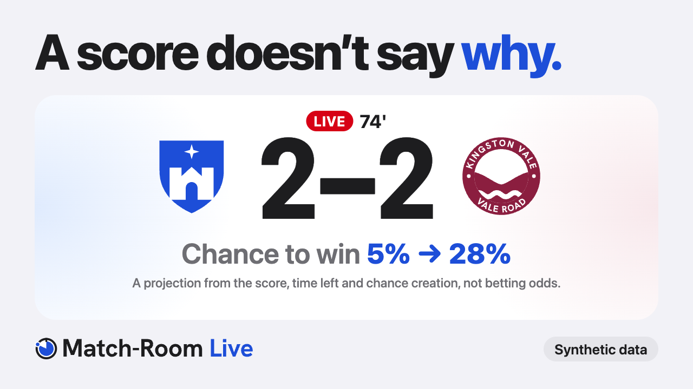

<p align="center">
  
</p>

# Match-Room Live

> Explain the match, don't just score it.

**[Demo video (2 min)](https://youtu.be/REPLACE_ME)** · **[Live preview](https://match-room-preview.pages.dev)** (no install) · **[Full app on Azure](https://victorious-sand-01b516100.2.azurestaticapps.net)** · [API docs](https://halftime-api.reddesert-2b0a0b71.southeastasia.azurecontainerapps.io/docs)

> [!NOTE]
> Our entry for the Microsoft × Premier League **Inside the Game** developer hackathon:
> *The Synthetic Match Insights Engine for Premier League Studio*. Every club, player and match
> in this repo is synthetic.

## In 30 seconds

| | |
|---|---|
| **The problem** | Stats tell fans *what* happened. They rarely say *why it mattered*, and fans don't trust AI that makes numbers up. |
| **Our answer** | A live engine that spots the moments that change a match and explains each one in a sentence, in English, Malay or Spanish, for casual fans or analysts. |
| **Why trust it** | Every number on screen traces back to real match events. A validator and an AI fact-checker reject anything the events don't back up. |

## The brief, stage by stage

| Stage | What we built | Code |
|---|---|---|
| **Ingest** | A possession-chain simulator where the ball moves event to event, plus scripted scenarios. Real feeds plug in through kloppy. | `sim/` |
| **Interpret** | xG, fitted xT, PPDA, field tilt, momentum, and our own "control vs chaos" index, minute by minute | `live/metrics.py` |
| **Explain** | Moment cards with their facts and evidence events; SHAP reasons for the half-time model | `live/insights.py`, `model/` |
| **Render** | Live cards, broadcast overlay messages, half-time and full-time briefs, a season table, a websocket stream | `api/`, `web/` |
| **Personalise** | English, Malay or Spanish; casual or analyst; favourite team; focus player | `live/engine.py` |

## Try it in two minutes

1. Open the **[live preview](https://match-room-preview.pages.dev)**. It plays a saved synthetic match in your browser, on desktop or phone.
2. Press **Kick-off**. The match plays at 60× speed.
3. Switch the language to **Bahasa Melayu** and the depth to **Analyst**. Same facts, different telling.
4. Tap any card's **facts checked** to see the events behind it.
5. Open the **[broadcast overlay](https://match-room-preview.pages.dev/overlay?minute=74&plate=1)** to see the studio graphics on the pitch.

The **[full app on Azure](https://victorious-sand-01b516100.2.azurestaticapps.net)** talks to the real
API, including the live websocket stream. The first load after a restart takes a few seconds.

## What makes it different

- **It explains, not just counts.** Each moment comes with one sentence on why it matters: a goal against the run of play, a momentum flip, a pressing spike, a chaos phase.
- **Proof is built in.** Card templates contain no digits, so every number comes from the match facts. A validator rejects any number or name the facts don't back up, and every card links to its events.
- **Two AI agents, one checks the other.** At half-time an Azure OpenAI analyst investigates the first half through tools and drafts the story. A fact-checker sends back unsupported cards. The page shows their trace.
- **It never breaks without AI.** With no keys, template text takes over and everything still runs.
- **Malay is a first-class language.** Built for the fan catching up the morning after a late kick-off in KL.

## Model performance

At half-time, our model predicts the final result better than four baselines, including
Dixon-Coles, a classic football model that knows the score and team strengths but not how the
first half was played.

Trained on 10,000 synthetic matches, tested on a held-out 20% (from `artifacts/metrics.json`;
regenerate with `make train`). Lower is better for log loss, RPS (ranked probability score) and
calibration error (the average gap between the probability we said and how often it happened).

| Final result | Log loss | RPS | Accuracy | Calibration error |
|---|---|---|---|---|
| Heuristic fallback | 0.757 | 0.133 | 65.1% | 0.048 |
| Baseline: pre-match strength only | 0.974 | 0.196 | 53.6% | 0.015 |
| Baseline: half-time score only | 0.822 | 0.152 | 61.9% | 0.016 |
| Baseline: Dixon-Coles (score + strengths) | 0.782 | 0.143 | 64.4% | 0.022 |
| **XGBoost on first-half features** | **0.729** | **0.129** | **66.6%** | 0.016 |

> [!TIP]
> **In plain words:** knowing *how* the first half was played beats knowing only the score. That's
> why the model's "why" reasons point at something real.

<details>
<summary><b>More results: next goal, live projection, simulator</b></summary>

- **Next-goal model** (home / away / none): log loss 0.996, accuracy 53.8%.
- **Live win projection** (`make live-calibration`, 2,000 fresh matches,
  `artifacts/live_calibration.json`): calibration error 0.011–0.043 from minute 10 to 85.
- **Simulated outcomes:** 40.4% home wins, 25.3% draws, 34.3% away wins, ~3.1 goals per match.
- On the v1 simulator, XGBoost and Dixon-Coles tied (0.666 vs 0.664): first-half play carried no
  information. The v2 possession-chain simulator fixed that.

</details>

<details>
<summary><b>Methodology: how we know the numbers mean something</b></summary>

All on synthetic matches.

| Piece | Method | Check |
|---|---|---|
| Simulator (`sim/chain.py`) | Possession chain: the ball moves from event to event; xG from shot distance and angle; hidden form on the day and momentum that persists | Totals near the v1 simulator (~3.1 goals, ~820 passes, ~27 shots); first-half play now predicts the second half |
| Half-time model | XGBoost on 13 first-half features, SHAP for the "why" | Beats four baselines, including Dixon-Coles, on log loss, RPS and calibration (`make train`) |
| Live win projection | Poisson, blending pre-match strength with live xG; two settings fitted | Calibration error 0.011–0.043 from minute 10 to 85 (`make live-calibration`) |
| xT | Karun Singh's value iteration on 3,000 simulated matches (`make xt`) | Predicts whether a possession scores better than a hand-drawn grid, on fresh matches |
| Live cards | Thresholds, re-tuned on one set of matches and checked on another | `scripts/card_value.py`: does the named side score next more often than strength predicts? |
| Real feeds | `sim/kloppy_io.py` converts to and from kloppy's event model, so any provider kloppy reads can drive the live engine | Exact round trip on simulated matches |

</details>

## Honest limits

- **All data is synthetic.** The engine can read real feeds through kloppy, but this repo holds no real data.
- **Draws run a little low.** The live projection says about 21–23% where simulated matches give 24%.
- **Tried and dropped:** change-point detection for momentum cards (no lift on held-out matches) and VAEP as a live metric (our simulator gives defenders no real decisions to credit).
- **Next, in order:** a "clearly on top" card built on momentum level, which does predict the next goal; a draw adjustment for the live projection; player positions in the simulator, which would make pitch control and VAEP worth adding.

## Run it locally

Needs Python 3.11+ and Node 20+.

```bash
make setup     # venv + Python deps + web deps
make api       # terminal 1: API on http://localhost:8000 (docs at /docs)
make web       # terminal 2: site on http://localhost:5173
```

No `make` (e.g. Windows)? Run the commands in the [Makefile](Makefile) directly, e.g.
`python -m venv .venv`, `.venv\Scripts\pip install -e ".[all]"`, `cd web && npm install`.

The repo ships with a trained model in `artifacts/`. To retrain: `make train` (10,000 matches,
~7 min). Azure OpenAI is optional: copy `.env.example` to `.env` and fill in the keys for
agent-written stories.

<details>
<summary><b>Try the API with curl</b></summary>

```bash
curl "localhost:8000/api/scenarios"
curl "localhost:8000/api/matches/SCN-comeback/live?minute=67&lang=ms&persona=casual&team=NGC"
curl "localhost:8000/api/matches/SCN-comeback/brief/fulltime?persona=analyst"
# websocket: ws://localhost:8000/api/matches/SCN-comeback/stream?speed=60
```

</details>

## Built with

Python · FastAPI (REST + websocket) · React + Vite · XGBoost + SHAP · Azure OpenAI ·
Azure Container Apps (API) · Azure Static Web Apps (website)

<details>
<summary><b>Repo layout and docs</b></summary>

```
contract/   API contracts (Pydantic) + JSON schemas + real samples          ← both
sim/        possession-chain simulator, scenarios, kloppy adapter          ← Ingest
live/       metrics, fitted xT, insights, narration + validator, engine    ← Interpret, Explain, Personalise
model/      half-time features, XGBoost + SHAP, half-time story + agents   ← Interpret, Explain
api/        FastAPI backend: REST + websocket stream                       ← Render
web/        React + Vite site                                              ← Render
tests/      pytest suite
scripts/    schemas + mocks, live calibration, card value check, VAEP prototype
docs/       live engine, frontend guide, architecture, API contract, workflow, deploy, demo
```

- [How the live engine works: every metric, threshold and rule](docs/live-engine.md)
- [Frontend guide: which endpoint powers which screen](docs/frontend-guide.md)
- [Architecture and the five challenge stages](docs/architecture.md)
- [API contract](docs/api-contract.md)
- [Team workflow](docs/workflow.md)
- [Deploying to Azure](docs/deploy-azure.md)
- [Demo script](docs/demo-script.md)

</details>

## Team

**Syahmi**: simulator, live engine, model, API · **Ilham**: website, design, Azure deployment, demo video
