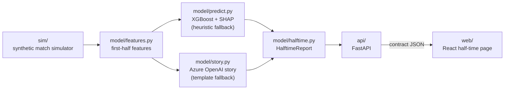

# Architecture

Data flows one way. The API's JSON (`contract/models.py`) is the handover point
between the data side (Syahmi) and the web side (Ilham).

## Mapping to the five challenge stages

| Stage | Where | What it does |
|---|---|---|
| Ingest | `sim/` | Generates football-realistic synthetic events (minute, team, player, type, x/y, outcome, xG) |
| Interpret | `model/features.py` | Turns first-half events into features: xG, shots, tilt, possession, cards, momentum by 15-minute block |
| Explain | `model/predict.py`, `model/story.py` | Result + next-goal probabilities, top SHAP factors, evidence-linked half-time story, what to watch |
| Render | `api/`, `web/` | JSON API and the half-time page with replay to 45' |
| Personalize | (stretch) | Fan / analyst / studio views of the same report |

## Design rules

- **No second-half leakage.** Features only read events with `minute <= 45`. `tests/test_model.py` checks this.
- **Always a fallback.** No trained model → heuristic predictor. No Azure OpenAI keys or an LLM error → template story. The page never breaks at half-time.
- **Evidence or it didn't happen.** Every story card cites event IDs; LLM-cited IDs that don't exist are dropped.
- **Beat the baseline.** `model/train.py` always reports the score-only baseline next to XGBoost.
