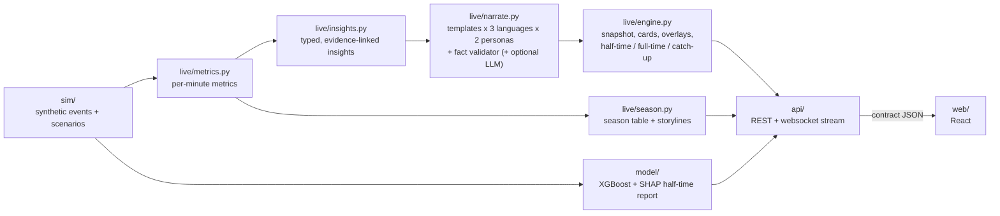

# Architecture

Data flows one way. The API's JSON (`contract/`) is the handover point between the backend
(Syahmi) and the frontend (Ilham).

## Mapping to the five challenge stages

| Stage | Where | What it does |
|---|---|---|
| Ingest | `sim/` | Football-realistic synthetic events (passes with end point, speed and pressure; shots with xG and speed; pressures, tackles, interceptions, fouls, cards, corners), match metadata, scripted scenarios |
| Interpret | `live/metrics.py`, `model/features.py` | xG, xT, possession, field tilt, PPDA, pass difficulty, momentum, control vs chaos, tempo, win projection, player lines |
| Explain | `live/insights.py`, `model/predict.py` | Typed insights with facts and evidence (goal against the run of play, momentum flip, pressure spike...); SHAP factors for the half-time model |
| Render | `live/narrate.py`, `live/engine.py`, `api/`, `web/` | Validated cards, timed overlay messages, snapshots, websocket stream, briefs |
| Personalise | `live/engine.py` | Casual / analyst, favourite team, focus player, English / Malay / Spanish |

Details of every metric and rule: [live-engine.md](live-engine.md).

## Design rules

- **No future leakage.** Live state at minute *m* only reads events with `minute <= m`
  (`tests/test_live_metrics.py`); half-time features only read `minute <= 45`
  (`tests/test_model.py`).
- **Every number is provable.** No digits in templates; the validator rejects any number,
  player or team not in the insight's facts, for templates and LLM output alike.
- **Always a fallback.** No trained model → heuristic predictor. No Azure OpenAI keys, an LLM
  error or an unprovable LLM sentence → template text. The page never breaks.
- **Evidence or it didn't happen.** Every card cites event IDs.
- **The core match never changes.** Simulator enrichment uses its own random stream, so the
  trained model stays valid.
- **Beat the baseline.** `model/train.py` always reports the score-only baseline next to XGBoost.
